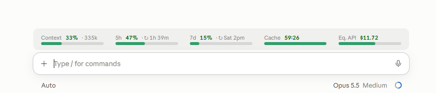

# OdinsEntropys Claude Marketplace

Claude Code mods by OdinsEntropy.

## Usage

#### Installation

From a terminal:

```bash
claude plugin marketplace add OdinsEntropy/claude-marketplace
claude plugin install desktop-statusline@odinsentropy
```

Or at the prompt of a terminal session:
```bash
/plugin install desktop-statusline --marketplace OdinsEntropy/claude-marketplace
```

In the desktop app: click **+** next to the prompt box, then **Plugins**, **Add marketplace** with `OdinsEntropy/claude-marketplace`, then add **desktop-statusline**. Start a new session afterwards, or run `/reload-plugins` in an open one.

#### Update

```bash
claude plugin update desktop-statusline@odinsentropy
```

#### Remove

```bash
claude plugin uninstall desktop-statusline@odinsentropy
```

Mods need Claude Code 2.1.287 or newer. A mod runs with your permissions: this one reads the session's usage figures and draws them, and makes no network calls and runs no commands.

## Plugins
Currently available plugins.

## desktop-statusline

> **Claude desktop app only.** It draws in the Code tab of the desktop app and nowhere else: in the terminal (CLI) and in the VS Code extension it shows nothing.

A usage bar above the prompt. It shows at a glance:



| Block | Shows | Bar |
|---|---|---|
| **Context** | how full the context window is, and the tokens in it | green → yellow → orange → red as it fills |
| **5h** | the 5-hour usage limit, and the time until it resets | same colours |
| **7d** | the 7-day usage limit, and the day and hour it resets | same colours |
| **Cache** | how long the prompt cache stays warm, counting down live | runs down until the cache goes cold |
| **Eq. API** | what this session would cost at API prices | fills up to $20, light blue from $40, gold from $100 |

Rest the pointer on the Context, 5h or 7d bar for the full numbers and reset time.

Because it only draws on the desktop, a `statusLine` you set in `settings.json` for the terminal keeps working as before.

The cache countdown assumes the one-hour cache of a Claude subscription, and five minutes when there are no usage limits (an API key). The cost is Claude Code's own estimate, the same figure `/cost` shows, not what a subscription charges.